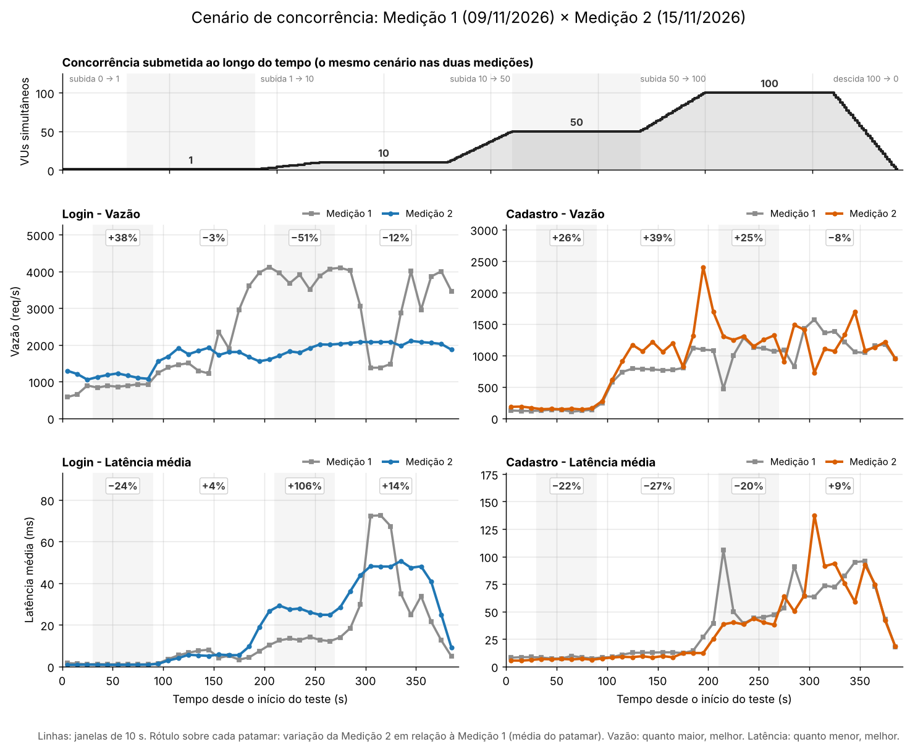
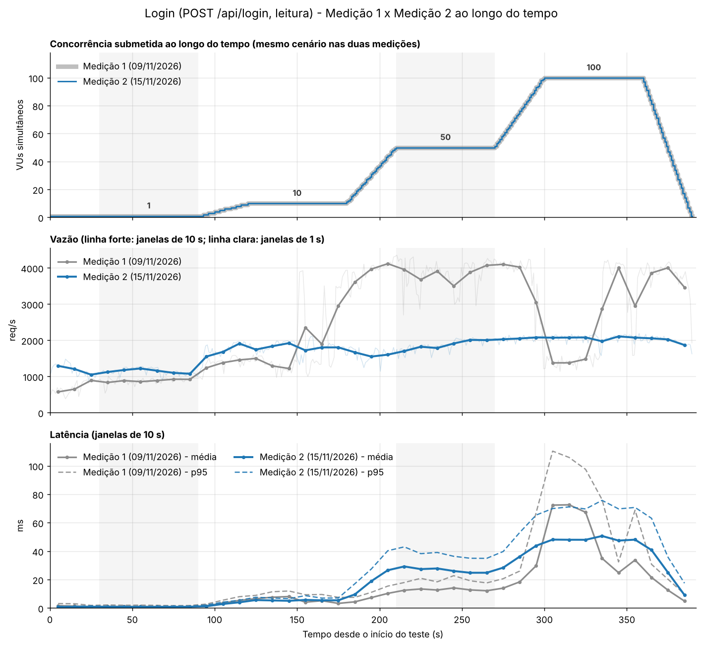
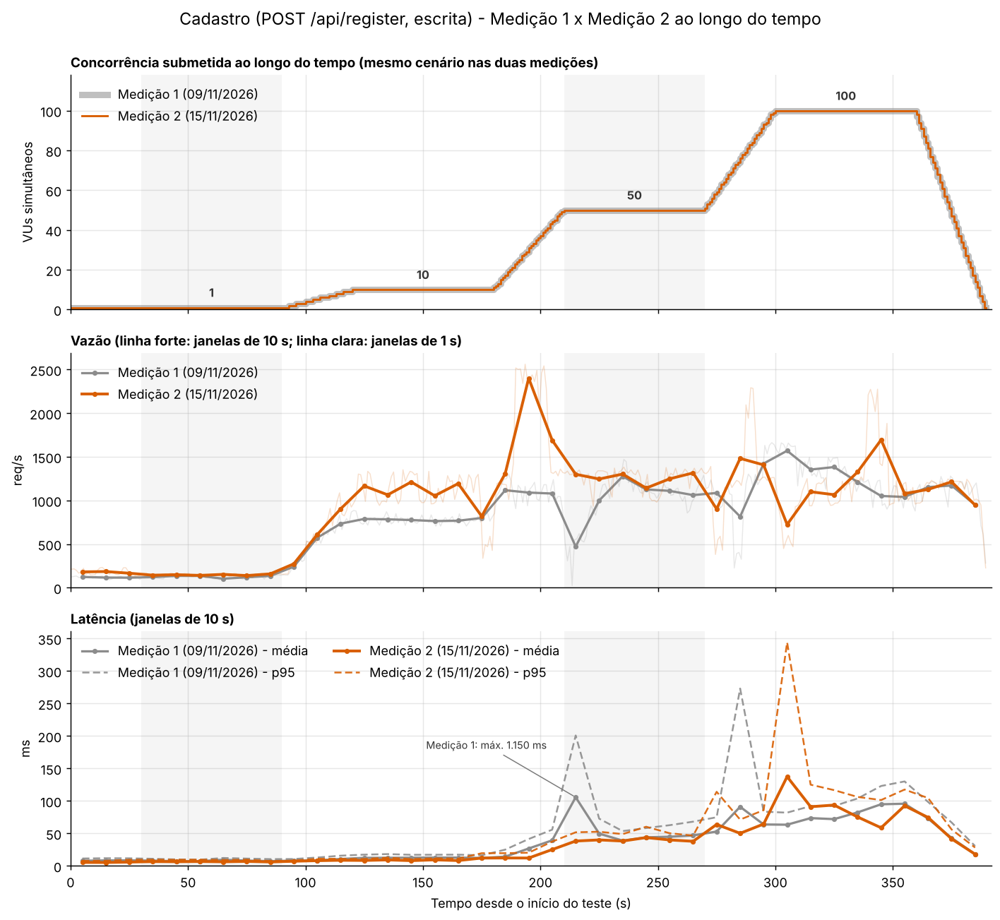

# 🐾 Adopets

Plataforma web de adoção de animais: anúncios de pets, chat entre usuários, pedidos de adoção, postagens, eventos e ONGs. O servidor é feito em **Node.js + Express**, os dados ficam em **MySQL** e o front-end é HTML/CSS/JavaScript servido pelo próprio Express.

Este repositório também contém a **entrega de Testes de Carga** (k6) dos serviços de **Login** e **Cadastro**, com duas medições (antes e depois das otimizações), gráficos comparativos e levantamento de hipóteses de gargalos.

---

## 📑 Entrega: Testes de Carga

> 👉 **Relatório completo: [RELATORIO.md](RELATORIO.md)**

Foram feitas **duas medições com o mesmo cenário de carga**: a **Medição 1** (09/11/2026, sistema original) e a **Medição 2** (15/11/2026, depois de otimizar os gargalos levantados). Tudo o que compõe a entrega pode ser acessado a partir desta página:

| O quê | Onde |
|---|---|
| Relatório das medições (SLA, gráficos comparativos, otimizações e hipóteses de gargalos) | [RELATORIO.md](RELATORIO.md) |
| Resumo executivo (Medição 1 × Medição 2) | [RELATORIO.md#1-resumo-executivo](RELATORIO.md#1-resumo-executivo) |
| Seção do Login (leitura): Medição 1, Medição 2, gráficos comparativos e otimizações | [RELATORIO.md#3-serviço-1--login](RELATORIO.md#3-serviço-1--login) |
| Seção do Cadastro (escrita): Medição 1, Medição 2, gráficos comparativos e otimizações | [RELATORIO.md#4-serviço-2--cadastro](RELATORIO.md#4-serviço-2--cadastro) |
| Melhorias/otimizações do Login (arquivos modificados) | [RELATORIO.md#38-melhoriasotimizações-arquivos-modificados](RELATORIO.md#38-melhoriasotimizações-arquivos-modificados) |
| Melhorias/otimizações do Cadastro (arquivos modificados) | [RELATORIO.md#48-melhoriasotimizações-arquivos-modificados](RELATORIO.md#48-melhoriasotimizações-arquivos-modificados) |
| Comparação entre os serviços | [RELATORIO.md#5-comparação-entre-os-serviços](RELATORIO.md#5-comparação-entre-os-serviços) |
| Hipóteses de gargalos do Login (Medição 1 e Medição 2) | [3.5](RELATORIO.md#35-medição-1-potenciais-gargalos-do-sistema-hipóteses) · [3.9](RELATORIO.md#39-medição-2-potenciais-gargalos-que-restam) |
| Hipóteses de gargalos do Cadastro (Medição 1 e Medição 2) | [4.5](RELATORIO.md#45-medição-1-potenciais-gargalos-do-sistema-hipóteses) · [4.9](RELATORIO.md#49-medição-2-potenciais-gargalos-que-restam) |
| Quadro-resumo das hipóteses | [RELATORIO.md#6-levantamento-de-hipóteses-dos-gargalos](RELATORIO.md#6-levantamento-de-hipóteses-dos-gargalos) |
| Script k6 do Login (o mesmo nas duas medições) | [testes-de-carga/login.js](testes-de-carga/login.js) |
| Script k6 do Cadastro (o mesmo nas duas medições) | [testes-de-carga/cadastro.js](testes-de-carga/cadastro.js) |
| Agregação do JSON bruto por janelas de 1 s, 5 s e 10 s | [testes-de-carga/analisar.js](testes-de-carga/analisar.js) |
| Geração dos gráficos (uma medição ou comparativo) | [testes-de-carga/gerar_graficos.py](testes-de-carga/gerar_graficos.py) |
| Ambiente das medições (máquina, versões, configuração) | [testes-de-carga/resultados/ambiente.md](testes-de-carga/resultados/ambiente.md) |
| Resultados do k6, Medição 1 (09/11/2026) | [resumo do Login](testes-de-carga/resultados/2026-11-09/login-resumo.json) · [resumo do Cadastro](testes-de-carga/resultados/2026-11-09/cadastro-resumo.json) |
| Resultados do k6, Medição 2 (15/11/2026) | [resumo do Login](testes-de-carga/resultados/2026-11-15/login-resumo.json) · [resumo do Cadastro](testes-de-carga/resultados/2026-11-15/cadastro-resumo.json) |
| Dados agregados por janela, Medição 1 (base dos gráficos) | [Login](testes-de-carga/resultados/2026-11-09/login-agregado.json) · [Cadastro](testes-de-carga/resultados/2026-11-09/cadastro-agregado.json) |
| Dados agregados por janela, Medição 2 (base dos gráficos) | [Login](testes-de-carga/resultados/2026-11-15/login-agregado.json) · [Cadastro](testes-de-carga/resultados/2026-11-15/cadastro-agregado.json) |

### 📈 Gráficos

**Comparativos Medição 1 × Medição 2** (pasta [`graficos/comparativo_2026-11-09_vs_2026-11-15`](testes-de-carga/graficos/comparativo_2026-11-09_vs_2026-11-15)). Nos gráficos de evolução, o painel superior é a **concorrência submetida**, e os de baixo, a **vazão** e a **latência**, no mesmo eixo de tempo. A Medição 1 é cinza e a Medição 2 tem a cor do serviço:

| Gráfico | Arquivo |
|---|---|
| Login: **concorrência**, vazão e latência no tempo, Medição 1 × Medição 2 | [login_comparativo_tempo.png](testes-de-carga/graficos/comparativo_2026-11-09_vs_2026-11-15/login_comparativo_tempo.png) |
| Cadastro: **concorrência**, vazão e latência no tempo, Medição 1 × Medição 2 | [cadastro_comparativo_tempo.png](testes-de-carga/graficos/comparativo_2026-11-09_vs_2026-11-15/cadastro_comparativo_tempo.png) |
| Login: vazão e latência por nível de concorrência | [login_comparativo_por_vus.png](testes-de-carga/graficos/comparativo_2026-11-09_vs_2026-11-15/login_comparativo_por_vus.png) |
| Cadastro: vazão e latência por nível de concorrência | [cadastro_comparativo_por_vus.png](testes-de-carga/graficos/comparativo_2026-11-09_vs_2026-11-15/cadastro_comparativo_por_vus.png) |
| **Cenário de concorrência submetido ao longo do tempo**, com o resultado de cada patamar nas duas medições | [comparativo_concorrencia_cenarioa.png](testes-de-carga/graficos/comparativo_2026-11-09_vs_2026-11-15/comparativo_concorrencia_cenarioa.png) |
| Indicadores globais do teste inteiro | [comparativo_resumo.png](testes-de-carga/graficos/comparativo_2026-11-09_vs_2026-11-15/comparativo_resumo.png) |

**Gráficos de cada medição** (mesmos nomes nas duas pastas: [`2026-11-09`](testes-de-carga/graficos/2026-11-09) e [`2026-11-15`](testes-de-carga/graficos/2026-11-15)): `login_evolucao.png`, `cadastro_evolucao.png`, `concorrencia_cenario.png`, `comparacao_por_vus.png`, `comparacao_evolucao.png` e `comparacao_resumo.png`.

**Cenário de concorrência submetido ao longo do tempo** (o mesmo nos dois serviços e nas duas medições; em cada patamar: Medição 1 → Medição 2):



**Login: concorrência, vazão e latência ao longo do tempo (Medição 1 × Medição 2):**



**Cadastro: concorrência, vazão e latência ao longo do tempo (Medição 1 × Medição 2):**



### 🔎 Resumo dos resultados (Medição 1 × Medição 2)

Rampa de 1 → 10 → 50 → 100 usuários virtuais, sem tempo de espera, durante 390 s, com k6, servidor e MySQL na mesma máquina. Variação = `(Medição 2 − Medição 1) ÷ Medição 1`.

| | Login M1 (09/11) | Login M2 (15/11) | Variação | Cadastro M1 (09/11) | Cadastro M2 (15/11) | Variação |
|---|---:|---:|---:|---:|---:|---:|
| Requisições | 939.635 | 669.424 | −28,8 % | 308.809 | 367.451 | +19,0 % |
| Vazão média | 2.409 req/s | 1.716 req/s | −28,8 % | 792 req/s | 942 req/s | +19,0 % |
| Latência média | 15,29 ms | 21,54 ms | +40,9 % | 46,69 ms | 39,32 ms | −15,8 % |
| Latência p95 | 56,54 ms | 60,18 ms | +6,4 % | 96,61 ms | 100,48 ms | +4,0 % |
| Latência máxima | 345,18 ms | 232,68 ms | −32,6 % | 1.149,86 ms | 533,83 ms | −53,6 % |
| Erros | 0 % | 0 % | — | 0 % | 0 % | — |
| Saturação da vazão | ≈ 50 VUs | ≈ 10 VUs | — | entre 10 e 50 VUs | ≈ 10 VUs | — |

O Login da Medição 2 é a execução de 14:54 e o Cadastro da Medição 2, a de 20:35 (15/11/2026).

Os dois serviços atenderam ao limite de exemplo (`p95 < 1000 ms` e `erros < 1 %`) nas duas medições. **O Cadastro melhorou** na vazão média (+19,0 %), na latência média (−15,8 %) e na latência máxima (−53,6 %), com o p95 praticamente igual (+4,0 %); o ganho está de 1 a 50 VUs e **se inverte com 100 VUs** (vazão −8,2 %, p95 +18,1 %). As paradas de 3–4 s não apareceram nesta execução, mas a causa não foi confirmada. **O Login não melhorou na vazão** (com 1 VU a latência caiu 24 %, mas com 50 VUs a vazão caiu 51 %); com uma rodada só, as otimizações não podem ser separadas das diferenças de ambiente entre as medições. Detalhes, gráficos e hipóteses estão no [RELATORIO.md](RELATORIO.md).

### 🛠️ O que foi otimizado entre as medições

Arquivos modificados: [`server.js`](server.js) e [`B.arquivo.env`](B.arquivo.env), mais a configuração do MySQL (fora do repositório). `login.js`, `cadastro.js`, `analisar.js` e `mysql/Adopetz.sql` **não** foram alterados, para a comparação valer.

| Mudança | Serviço | Hipótese |
|---|---|---|
| Cadastro sem o `SELECT` de duplicidade: só o `INSERT`, com `ER_DUP_ENTRY` virando `409` | Cadastro | C4 |
| Login com `SELECT id, nome, email`, sessão só com `{ id }` e resposta sem a senha | Login | L1 |
| Pool configurável (`DB_POOL_SIZE`) e pré-aquecido na partida (`DB_PREWARM`) | Login e Cadastro | L2, C4 |
| Prepared statements nas consultas do login e do cadastro (`DB_USE_EXECUTE`) | Login e Cadastro | L1, C4 |
| Sem `X-Powered-By` e sem ETag; `express.static` antes da sessão | Login e Cadastro | L1 |
| Cluster opcional (`CLUSTER_WORKERS`), **implementado mas não medido** | Login e Cadastro | L1 |
| MySQL: `innodb_redo_log_capacity` = 2 GB e `innodb_buffer_pool_size` = 1 GB (`SET PERSIST`) | Cadastro | C2, C3 |

A lista completa, com as linhas do `server.js`, está em [3.8](RELATORIO.md#38-melhoriasotimizações-arquivos-modificados) e [4.8](RELATORIO.md#48-melhoriasotimizações-arquivos-modificados) do relatório.

### 🧠 Hipóteses de gargalos

Cada hipótese está detalhada, com evidência nos dados e experimento de validação, em [Login (3.5 e 3.9)](RELATORIO.md#3-serviço-1--login) e [Cadastro (4.5 e 4.9)](RELATORIO.md#4-serviço-2--cadastro). Resumo:

| ID | Serviço | Hipótese de gargalo | Situação depois da Medição 2 |
|---|---|---|---|
| L1 | Login | CPU do Node (thread única) como teto de vazão (≈ 4.100 req/s a partir de 50 VUs na Medição 1) | Não testada (cluster não medido) |
| L2 | Login | Fila no pool de 10 conexões do MySQL | Não testada (pool 10 nas duas medições) |
| L3 | Login | Instabilidade ambiental no patamar de 100 VUs (vazão cai de ≈ 4.000 para ≈ 1.400 req/s por ≈ 35 s) | Não reapareceu |
| L4 | Login | Custo de autenticação irrealisticamente baixo: senha comparada em texto puro, sem hash | Mantida de propósito |
| L5 | Login | Condições do ambiente diferentes entre as medições (horário, carga da máquina) | Aberta |
| L6 | Login | Efeito das mudanças no caminho do login sob concorrência (`execute`, colunas, sessão) | Aberta |
| C1 | Cadastro | Custo da escrita durável (commit no InnoDB): ≈ 8 ms por requisição com 1 VU | Continua sendo a principal hipótese |
| C2 | Cadastro | Manutenção de 3 índices e crescimento da tabela | Atenuada (sem queda no patamar de 100 VUs), mas a vazão com 100 VUs ficou 8,2 % abaixo da Medição 1 |
| C3 | Cadastro | Paradas curtas de 3–4 s | **Não reapareceu nesta execução** (máx. 534 ms); causa não confirmada |
| C4 | Cadastro | Fila no pool, com duas consultas por requisição | Atendida em parte (1 consulta a menos); o pool não limitou uma janela de ≈ 14 s a ≈ 2.400 req/s |
| C5 | Cadastro | Vazão variável no tempo (janela de ≈ 14 s com o dobro da vazão do resto do teste) | Aberta |

---

## 📦 Estrutura do Projeto

```plaintext
.
├── server.js                      # Servidor Express: rotas da API e inicialização do banco
├── package.json                   # Dependências do Node
├── B.arquivo.env                  # Modelo das variáveis de ambiente (copie para .env)
├── mysql/
│   └── Adopetz.sql                # Criação e carga inicial do banco "adopetz"
├── public/                        # Front-end (HTML, CSS, JS, imagens)
├── README.md                      # Este arquivo
├── RELATORIO.md                   # Relatório dos testes de carga
└── testes-de-carga/
    ├── login.js                   # Teste k6: POST /api/login
    ├── cadastro.js                # Teste k6: POST /api/register
    ├── analisar.js                # Reduz o JSON bruto do k6 a janelas de 1 s, 5 s e 10 s
    ├── gerar_graficos.py          # Gera os gráficos (uma medição ou comparativo entre duas)
    ├── graficos/
    │   ├── 2026-11-09/            # Gráficos (PNG) da Medição 1
    │   ├── 2026-11-15/            # Gráficos (PNG) da Medição 2
    │   └── comparativo_2026-11-09_vs_2026-11-15/   # Medição 1 x Medição 2
    └── resultados/
        ├── ambiente.md            # Máquina, versões e configuração das duas medições
        ├── 2026-11-09/            # Medição 1: resumos do k6 e dados agregados (JSON)
        └── 2026-11-15/            # Medição 2: resumos do k6 e dados agregados (JSON)
```

---

## 🚀 Execução local

1. **Clone o repositório:**

   ```bash
   git clone https://github.com/jotinhakkk/Adopets
   cd Adopets
   ```

2. **Instale as dependências:**

Execução Local


   ```bash
   npm install
   ```

3. **Configure o banco de dados MySQL.** Copie `B.arquivo.env` para `.env` e preencha as credenciais (`DB_HOST`, `DB_PORT`, `DB_USER`, `DB_PASSWORD`, `DB_NAME`, `PORT` e `SESSION_SECRET`). O `dotenv` só lê o `.env`, então copie também as variáveis de desempenho, todas opcionais: `DB_POOL_SIZE` (conexões do pool, padrão 10), `CLUSTER_WORKERS` (processos Node, padrão 1), `DB_PREWARM` (pré-aquece o pool, padrão ligado) e `DB_USE_EXECUTE` (prepared statements, padrão desligado). Com o MySQL em execução, o servidor cria e popula o banco `adopetz` automaticamente na primeira inicialização, a partir de `mysql/Adopetz.sql`.


4. **Inicie o servidor:**

=======
3. Configure o banco de dados MySQL e insira as credenciais no arquivo de conexão.

4. Inicie o servidor local:

   ```bash
   node server.js
   ```

5. **Acesse no navegador:** 🔗 **http://localhost:3000**

---

## 🧪 Como reproduzir os testes de carga

Pré-requisitos: [k6](https://k6.io/docs/getting-started/installation/) e Node.js instalados, MySQL em execução e o servidor rodando (`node server.js`). O teste de Login precisa de um usuário já cadastrado.

Execute a partir da pasta `testes-de-carga/` e crie antes a pasta do dia (por exemplo, `resultados/2026-11-15`). Os exemplos abaixo são da **Medição 2**; para a Medição 1, troque a data por `2026-11-09`.

```bash
cd testes-de-carga

# Login
k6 run -e LOGIN_EMAIL=karenzinha123@email.com -e LOGIN_SENHA=senha123 --summary-export=resultados/2026-11-15/login-resumo.json --out json=resultados/2026-11-15/login.json login.js

# Cadastro
k6 run --summary-export=resultados/2026-11-15/cadastro-resumo.json --out json=resultados/2026-11-15/cadastro.json cadastro.js

# Agregação do JSON bruto (vários GB, não versionado)
node analisar.js resultados/2026-11-15/login.json
node analisar.js resultados/2026-11-15/cadastro.json

pip install matplotlib

# Gráficos de uma medição, em graficos/2026-11-15/
python gerar_graficos.py 2026-11-15

# Gráficos de cada medição + comparativos Medição 1 x Medição 2,
# em graficos/comparativo_2026-11-09_vs_2026-11-15/ (primeira data = Medição 1)
python gerar_graficos.py 2026-11-09 2026-11-15
```

Para que a Medição 2 seja comparável à Medição 1: mesma máquina e mesma versão do k6, reinicie o Node e o MySQL antes de cada teste e limpe os usuários de teste antes do Cadastro. A configuração do MySQL usada (`SET PERSIST`) e a limpeza estão na [seção 8 do relatório](RELATORIO.md#8-como-reproduzir). O teste de cadastro insere de 300 a 360 mil usuários de teste.

---

## 🛠️ Tecnologias utilizadas

- Node.js, Express, express-session, multer
- MySQL (driver `mysql2`)
- HTML, CSS e JavaScript no front-end
- k6 para os testes de carga
- Node.js (agregação) e Python com matplotlib (gráficos)
=======
5. Acesse via navegador: `http://localhost:3000`


