# 📊 Relatório de Testes de Carga — Adopets

Medição de **latência**, **vazão** e **concorrência** dos dois serviços do Adopets que acessam o banco de dados: **Login** (leitura) e **Cadastro** (escrita). Ferramenta: [k6](https://k6.io/). Foram feitas **duas medições com o mesmo cenário de carga**: a **Medição 1** (09/11/2026, sistema original) e a **Medição 2** (15/11/2026, depois de otimizar os gargalos levantados na Medição 1).

> 🔙 Voltar para o [README](README.md)

## Sumário

1. [Resumo executivo](#1-resumo-executivo)
2. [Metodologia e ambiente](#2-metodologia-e-ambiente)
3. [Serviço 1 — Login](#3-serviço-1--login)
4. [Serviço 2 — Cadastro](#4-serviço-2--cadastro)
5. [Comparação entre os serviços](#5-comparação-entre-os-serviços)
6. [Levantamento de hipóteses dos gargalos](#6-levantamento-de-hipóteses-dos-gargalos)
7. [Limitações da medição](#7-limitações-da-medição)
8. [Como reproduzir](#8-como-reproduzir)
9. [Ferramentas e links úteis](#9-ferramentas-e-links-úteis)

---

## 1. Resumo executivo

Nas duas medições, cada serviço recebeu uma rampa de **1 → 10 → 50 → 100 usuários virtuais (VUs)**, sem tempo de espera entre requisições, durante 6 min 30 s (390 s). Entre uma medição e a outra foram otimizados o servidor (`server.js`) e o MySQL; a lista completa está em [3.8](#38-melhoriasotimizações-arquivos-modificados) (Login) e [4.8](#48-melhoriasotimizações-arquivos-modificados) (Cadastro). A variação é `(Medição 2 − Medição 1) ÷ Medição 1`.

| Indicador (teste inteiro) | Login M1 | Login M2 | Variação | Cadastro M1 | Cadastro M2 | Variação |
|---|---:|---:|---:|---:|---:|---:|
| Requisições | 939.635 | 669.424 | −28,8 % | 308.809 | 355.712 | +15,2 % |
| Vazão média | 2.409 req/s | 1.716 req/s | −28,8 % | 792 req/s | 912 req/s | +15,2 % |
| Pico de vazão (janela de 10 s) | 4.117 req/s | 2.108 req/s | −48,8 % | 1.570 req/s | 1.893 req/s | +20,6 % |
| Latência média | 15,29 ms | 21,54 ms | +40,9 % | 46,69 ms | 40,53 ms | −13,2 % |
| Latência mediana | 11,06 ms | 22,04 ms | +99,2 % | 43,70 ms | 37,43 ms | −14,3 % |
| Latência p95 | 56,54 ms | 60,18 ms | +6,4 % | 96,61 ms | 84,33 ms | −12,7 % |
| Latência máxima | 345,18 ms | 232,68 ms | −32,6 % | 1.149,86 ms | 4.698,82 ms | +308,6 % |
| Erros (`http_req_failed`) | 0 % | 0 % | — | 0 % | 0 % | — |
| Checks (200 / 201) | 100 % | 100 % | — | 100 % | 100 % | — |
| Limite do SLA de exemplo (`p95 < 1000 ms` e `erros < 1 %`) | ✅ | ✅ | — | ✅ | ✅ | — |

> Observação: a vazão acima é a informada pelo k6 (total ÷ 390 s). Os gráficos e as tabelas por janela usam a duração medida pelo `analisar.js` (391 s), por isso os gráficos de barras mostram, por exemplo, 2.403 e 790 req/s na Medição 1. A diferença é só de arredondamento do tempo. Nos dois casos, `M1` = Medição 1 e `M2` = Medição 2.

**Principais conclusões**

1. **Os dois serviços continuam atendendo o SLA de exemplo com folga** nas duas medições: 0 erros em ≈ 1,25 milhão de requisições (Medição 1) e em ≈ 1,03 milhão (Medição 2), com p95 bem abaixo de 1 s.
2. **O Cadastro melhorou** na maior parte dos indicadores: vazão média **+15,2 %**, latência média **−13,2 %** e p95 **−12,7 %**. O ganho é maior com pouca concorrência (10 VUs: vazão **+42,4 %**, latência média **−29,9 %**) e quase some com 100 VUs (vazão +4,5 %), provavelmente porque a gravação durável passa a ser o limite (hipótese C1).
3. **O Login não melhorou na vazão.** A média caiu **28,8 %** e a latência média subiu **40,9 %**. Com 1 VU ele ficou mais rápido (1,11 → 0,84 ms), mas a vazão deixou de crescer com os VUs (≈ 1.800–2.100 req/s desde 10 VUs) e não repetiu o patamar de ≈ 3.800–4.100 req/s que a Medição 1 teve com 50 VUs. Por outro lado, a queda de vazão com 100 VUs da Medição 1 não se repetiu. Como as mudanças foram aplicadas juntas e as duas medições foram feitas em horários diferentes, **os dados não separam o efeito das otimizações do efeito do ambiente** (hipóteses L5 e L6 em [3.9](#39-medição-2-potenciais-gargalos-que-restam)).
4. **As paradas curtas do Cadastro não foram eliminadas.** Na Medição 2 houve duas paradas de 3–4 s (t ≈ 194 s e t ≈ 340 s), com latência máxima de 3,1 s e 4,7 s, contra 1,15 s na Medição 1. Aumentar o redo log do InnoDB para 2 GB não resolveu (hipótese C3, em [4.9](#49-medição-2-potenciais-gargalos-que-restam)).
5. **O limite do sistema continua sem ser encontrado:** nenhum erro até 100 VUs sem tempo de espera.
6. ⚠️ **O Login continua comparando a senha em texto puro** (sem hash), de propósito: aplicar `bcrypt` mudaria o custo de cada login e invalidaria a comparação antes × depois. Trate isso como correção de segurança à parte (hipótese L4).

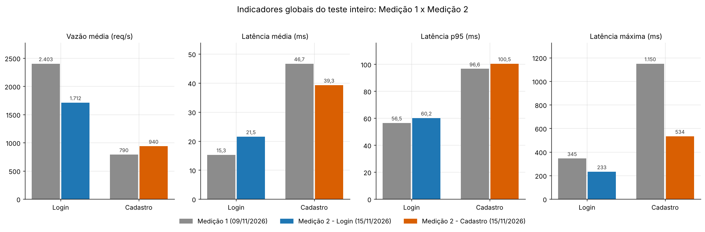

---

## 2. Metodologia e ambiente

### 2.1 Descrição das configurações (máquinas/containers)

Não foram usados containers: servidor, banco e gerador de carga rodaram diretamente no mesmo PC nas duas medições (detalhes em [`ambiente.md`](testes-de-carga/resultados/ambiente.md)). A tabela mostra o que mudou da Medição 1 para a Medição 2.

| Item | Medição 1 — 09/11/2026 | Medição 2 — 15/11/2026 |
|---|---|---|
| Máquina | PC, CPU Intel i5-13400, 32 GB de RAM, Windows | igual |
| Servidor | Node.js v24.22.0 + Express (porta 3000), 1 processo | igual (`CLUSTER_WORKERS=1`), com o `server.js` otimizado |
| Banco de dados | MySQL 8.4.7, local (banco `adopetz`) | igual |
| Pool de conexões do servidor | 10 (fixo) | 10 (`DB_POOL_SIZE=10`, agora configurável) |
| Pré-aquecimento do pool | não existia (conexões abertas sob demanda) | ligado (`DB_PREWARM=1`) |
| Consultas do login e do cadastro | `pool.query` | prepared statements, `pool.execute` (`DB_USE_EXECUTE=1`) |
| `innodb_redo_log_capacity` | 100 MB (padrão do MySQL 8.4) ¹ | **2 GB** (`SET PERSIST`) |
| `innodb_buffer_pool_size` | 128 MB (padrão do MySQL 8.4) ¹ | **1 GB** (`SET PERSIST`; redimensionamento concluído em 15/11/2026 às 14:21) |
| `innodb_flush_log_at_trx_commit` | 1 (padrão) | 1 (não alterado) |
| `max_connections` | 151 | 151 |
| Usuários no banco antes do teste | 3 | não registrado (ver [seção 7](#7-limitações-da-medição)) |
| Horário dos testes (fuso −03:00) | Login 02:45, Cadastro 02:58 | Login 14:54, Cadastro 15:02 |
| Gerador de carga | k6 v2.3.0 (windows/amd64), **na mesma máquina do servidor** | igual |
| Rede | Ethernet (as requisições foram para `localhost`) | igual |

¹ Os valores da Medição 1 são os padrões documentados do MySQL 8.4; a consulta `SHOW VARIABLES` feita antes da alteração não está nos arquivos do projeto. Se o seu valor anterior era outro, corrija esta tabela e o `ambiente.md`.

### 2.2 Perfil de carga (igual nos dois serviços)

Definido em [`login.js`](testes-de-carga/login.js) e [`cadastro.js`](testes-de-carga/cadastro.js) (variável `STAGES`, padrão `1,10,50,100`). **Os scripts k6 não foram alterados entre as medições**: a rampa e os limites são os mesmos. Cada degrau sobe em 30 s e se mantém por 1 min; no fim, desce a 0 em 30 s.

| Tempo (s) | Fase | VUs |
|---|---|---:|
| 0–30 | subida | 0 → 1 |
| 30–90 | patamar | 1 |
| 90–120 | subida | 1 → 10 |
| 120–180 | patamar | 10 |
| 180–210 | subida | 10 → 50 |
| 210–270 | patamar | 50 |
| 270–300 | subida | 50 → 100 |
| 300–360 | patamar | 100 |
| 360–390 | descida | 100 → 0 |

**Cenário de concorrência submetido ao longo do tempo** (o mesmo nos dois serviços e nas duas medições). Sobre cada patamar estão os resultados medidos, no formato *Medição 1 → Medição 2*:

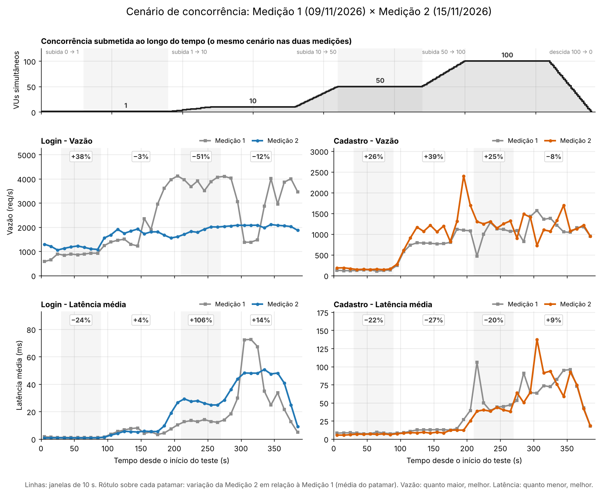

- **Sem tempo de espera** (`THINK_TIME=0`): cada VU dispara a próxima requisição assim que recebe a resposta. Isso mede a capacidade máxima do serviço, não o uso de pessoas reais.
- **Limites (thresholds) usados como SLA de exemplo:** `http_req_failed < 1 %` e `http_req_duration p(95) < 1000 ms`.

### 2.3 Como as métricas foram obtidas

| Métrica | Definição | Fonte |
|---|---|---|
| **Latência** | tempo de resposta da requisição (`http_req_duration`): média, mediana, p90, p95 e máximo | k6 (`--summary-export`) e janelas do `analisar.js` |
| **Vazão** | requisições por segundo, calculada em janelas de **1 s, 5 s e 10 s** e também por patamar | [`analisar.js`](testes-de-carga/analisar.js) |
| **Concorrência** | número de VUs simultâneos (`vus`), que equivale ao número de requisições em andamento, pois não há tempo de espera | k6 |

Fluxo de dados: `k6 run` gera o JSON bruto (vários GB, não versionado) → `analisar.js` reduz a poucos KB (`*-agregado.json`) → [`gerar_graficos.py`](testes-de-carga/gerar_graficos.py) produz os gráficos desta página. Com duas datas, o script gera também os **gráficos comparativos** (ver [seção 8](#8-como-reproduzir)).

**Como ler os gráficos comparativos.** Em todos eles a **Medição 1 é cinza** e a **Medição 2 tem a cor do serviço** (azul = Login, laranja = Cadastro). Linha cheia é a média; linha tracejada é o p95. O painel superior de cada gráfico de evolução é sempre a **concorrência submetida** (VUs simultâneos), e os painéis de baixo são a **vazão** e a **latência** no mesmo eixo de tempo.

---

## 3. Serviço 1 — Login

| Item | Descrição |
|---|---|
| **Endpoint** | `POST /api/login` |
| **Tipo de operação** | **Leitura** (`SELECT` na tabela `usuario` por e-mail e senha; se não achar, consulta também `administrador`). Também grava a sessão em memória. |
| **Medição 1** | 09/11/2026 (início às 02:45:06, fuso −03:00), sistema original |
| **Medição 2** | 15/11/2026 (início às 14:54:49, fuso −03:00), depois das otimizações |

### 3.1 Arquivos envolvidos

Os números de linha são os da versão atual (otimizada) do `server.js`.

- [`server.js` — rota `POST /api/login` (linhas 121–142)](server.js#L121-L142)
- [`server.js` — função `consultar()` (linhas 45–53)](server.js#L45-L53), [pool de conexões MySQL (linhas 34–43)](server.js#L34-L43) e [sessão em memória (linhas 75–79)](server.js#L75-L79)
- [`B.arquivo.env`](B.arquivo.env) — modelo das variáveis de ambiente, incluindo as da otimização
- [`public/login.html`](public/login.html) — formulário que chama `/api/login`
- [`mysql/Adopetz.sql` — tabela `usuario` (linhas 32–46)](mysql/Adopetz.sql#L32-L46), com índice `UNIQUE` em `email` e em `cpf`

### 3.2 Arquivos com o código-fonte da medição

- [`testes-de-carga/login.js`](testes-de-carga/login.js) — script k6 (o mesmo nas duas medições)
- [`testes-de-carga/analisar.js`](testes-de-carga/analisar.js) — agregação por janelas
- [`testes-de-carga/gerar_graficos.py`](testes-de-carga/gerar_graficos.py) — gráficos (uma medição ou comparativo)
- Resultados da Medição 1: [`login-resumo.json`](testes-de-carga/resultados/2026-11-09/login-resumo.json) (k6) e [`login-agregado.json`](testes-de-carga/resultados/2026-11-09/login-agregado.json) (janelas)
- Resultados da Medição 2: [`login-resumo.json`](testes-de-carga/resultados/2026-11-15/login-resumo.json) (k6) e [`login-agregado.json`](testes-de-carga/resultados/2026-11-15/login-agregado.json) (janelas)

### 3.3 Descrição das configurações

Máquina, versões de Node, MySQL e k6 e rede são os mesmos nas duas medições (tabela da [seção 2.1](#21-descrição-das-configurações-máquinascontainers)). O que mudou para o Login: pool de 10 conexões **pré-aquecido**, consultas por **prepared statement**, `SELECT` com só as colunas necessárias, e MySQL com **buffer pool de 1 GB** e **redo log de 2 GB**. O processo Node continua único e a senha continua em texto puro.

### 3.4 Medição 1: resultados (SLA observado)

**Data:** 09/11/2026. **Por nível de concorrência** (segundos em que havia exatamente N VUs ativos):

| VUs | Vazão (req/s) | Latência média (ms) | p95 (ms) | Máxima (ms) | Erros |
|---:|---:|---:|---:|---:|---:|
| 1 | 841,3 | 1,11 | 2,20 | 17,59 | 0 % |
| 10 | 1.869,7 | 5,24 | 9,81 | 69,86 | 0 % |
| 50 | 3.832,2 | 12,92 | 19,55 | 345,18 | 0 % |
| 100 | 2.342,2 | 42,57 | 88,87 | 341,54 | 0 % |

> A linha de 1 VU inclui os 94 s iniciais; as demais, 60 s cada.

**Evolução no tempo.** O painel superior mostra a **concorrência submetida** (VUs simultâneos); o do meio, a **vazão** (janelas de 1 s e 10 s); o inferior, a **latência** (janelas de 5 s). Os três compartilham o mesmo eixo de tempo:

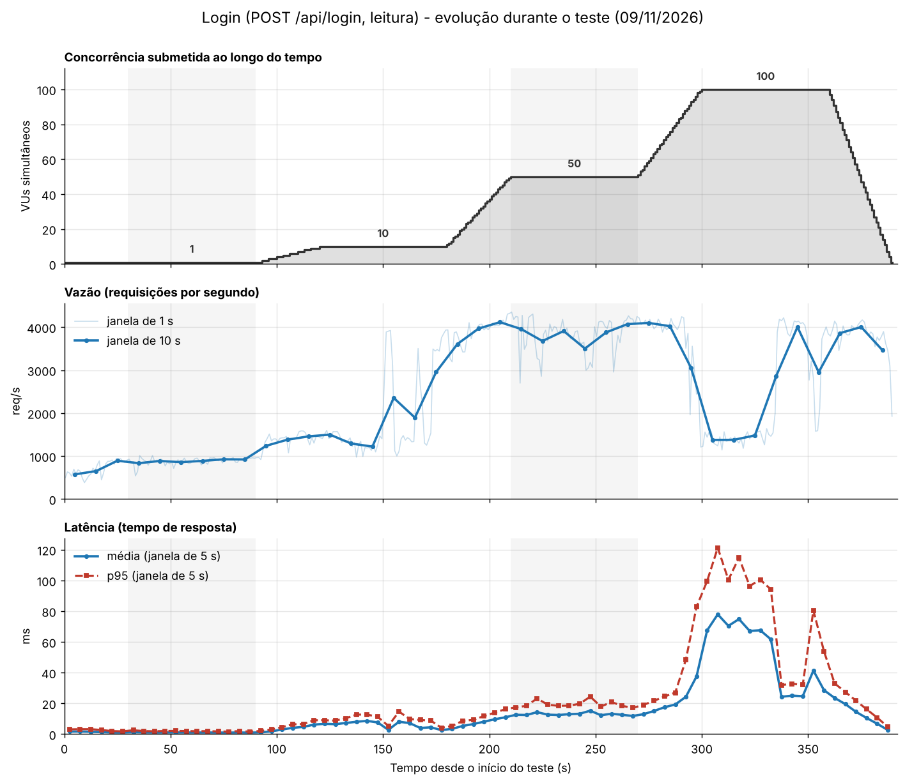

**Concorrência (limite de requisições simultâneas).** O cenário submetido foi a rampa 1 → 10 → 50 → 100 VUs (gráfico da [seção 2.2](#22-perfil-de-carga-igual-nos-dois-serviços) e painel superior acima). Como não há tempo de espera, cada VU mantém uma requisição em andamento, então **100 VUs ≈ 100 requisições simultâneas**. O máximo testado foi 100 simultâneas e **o limite de falha não foi atingido**: 0 % de erro e p95 de 88,87 ms nesse patamar. O que saturou foi a vazão, por volta de **50 VUs** (≈ 3.800–4.100 req/s).

**Leitura dos resultados**

- A vazão sobe junto com os VUs até **≈ 4.100 req/s com 50 VUs** (pico de 4.353 req/s em uma janela de 1 s) e não passa disso.
- **No patamar de 100 VUs a vazão não se mantém:** nos primeiros 30 s (t = 300–330 s) ela cai para ≈ 1.410 req/s com latência média de 71 ms; nos 30 s seguintes (t = 330–360 s) volta para ≈ 3.270 req/s e 31 ms. Não houve nenhum erro. Por isso a média do patamar (2.342 req/s) esconde **dois regimes** diferentes.
- O maior pico de latência (345 ms) ocorreu no início do patamar de 50 VUs (t ≈ 210 s); no patamar de 100 VUs o máximo foi de 342 ms, justamente no início da queda de vazão descrita acima.

### 3.5 Medição 1: potenciais gargalos do sistema (hipóteses)

Estas são **hipóteses**: as medições mostram *o que* aconteceu, mas não monitoraram CPU, memória e estado do MySQL durante o teste. Cada item traz a evidência encontrada e um experimento para confirmar ou descartar.

**L1 — CPU do Node (processo de thread única) como teto de vazão.**
- *Evidência:* a vazão para de crescer em ≈ 4.100 req/s a partir de 50 VUs, embora a consulta seja trivial (busca pelo índice `UNIQUE` de `email` numa tabela de 3 linhas) e, com 1 VU, a latência seja de apenas 1,1 ms.
- *Como validar:* observar o processo `node` durante o teste (um núcleo próximo de 100 % é a assinatura desse gargalo) ou subir duas instâncias (`cluster`/PM2) e verificar se a vazão máxima quase dobra.

**L2 — Fila no pool de 10 conexões do MySQL.**
- *Evidência:* com 100 VUs há até 90 requisições esperando conexão (`waitForConnections: true`, sem limite de fila), e a latência cresce na proporção dos VUs. Porém, com 50 VUs já havia 40 requisições na fila sem queda de vazão, então o pool **sozinho não explica** a perda a 100 VUs.
- *Como validar:* repetir o teste com `connectionLimit` de 10, 25 e 50 e comparar o p95 em 100 VUs.

**L3 — Instabilidade ambiental no patamar de 100 VUs** (vazão cai de ≈ 4.000 para ≈ 1.400 req/s por ≈ 35 s e volta sozinha, sem erros e com carga constante).
- *Hipóteses:* k6, Node e MySQL disputando CPU na mesma máquina (o i5-13400 mistura núcleos de desempenho e de eficiência), pausa de coleta de lixo (GC) do Node ou escalonamento do Windows. Uma falha de lógica da aplicação seria menos provável, pois o comportamento se desfaz sem mudança de carga.
- *Como validar:* repetir o teste pelo menos 3 vezes (se a queda mudar de horário ou sumir, é ambiental), rodar o k6 em outra máquina e iniciar o Node com `--trace-gc`.

**L4 — Custo de autenticação irrealisticamente baixo.**
- *Evidência no código:* o `SELECT` compara `senha` em texto puro (`WHERE email = ? AND senha = ?`) e o `bcrypt`, embora esteja no `package.json`, **não é usado** no `server.js`.
- *Impacto esperado (estimativa, não medida):* com hash de senha, cada login passaria a gastar CPU na verificação e o gargalo mudaria para esse cálculo; a vazão máxima provavelmente seria ordens de grandeza menor.
- *Como validar:* implementar a verificação com hash e repetir `login.js`.

### 3.6 Medição 2: resultados (SLA observado)

**Data:** 15/11/2026 (início às 14:54:49). Mesmo script e mesma rampa da Medição 1. A coluna *Var.* compara com a Medição 1 (tabela da [seção 3.4](#34-medição-1-resultados-sla-observado)).

| VUs | Vazão (req/s) | Var. | Latência média (ms) | Var. | p95 (ms) | Var. | Máxima (ms) | Erros |
|---:|---:|---:|---:|---:|---:|---:|---:|---:|
| 1 | 1.162,6 | +38,2 % | 0,84 | −24,3 % | 1,27 | −42,3 % | 20,20 | 0 % |
| 10 | 1.805,6 | −3,4 % | 5,43 | +3,6 % | 7,35 | −25,1 % | 43,02 | 0 % |
| 50 | 1.873,4 | −51,1 % | 26,59 | +105,8 % | 37,15 | +90,0 % | 171,15 | 0 % |
| 100 | 2.064,0 | −11,9 % | 48,36 | +13,6 % | 70,85 | −20,3 % | 232,68 | 0 % |

> A linha de 1 VU inclui os 94 s iniciais; as demais, 60 s cada.

**Evolução no tempo** (mesmos três painéis da Medição 1: concorrência, vazão e latência):

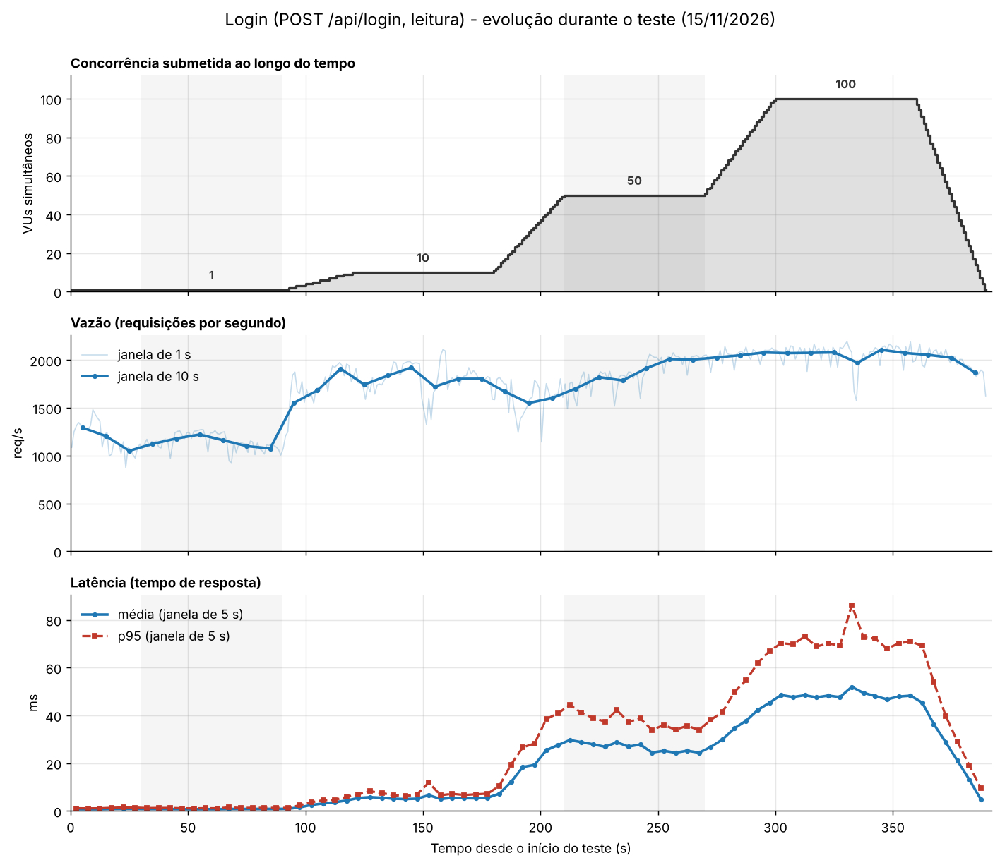

**Concorrência (limite de requisições simultâneas).** Mesmo cenário da Medição 1: rampa 1 → 10 → 50 → 100 VUs, ou seja, **até ≈ 100 requisições simultâneas**. O limite de falha também **não foi atingido**: 0 % de erro e p95 de 70,85 ms nesse patamar. A vazão, porém, satura mais cedo do que na Medição 1: já em **10 VUs** (≈ 1.800 req/s), chegando a ≈ 2.060 req/s com 100 VUs.

**Leitura dos resultados**

- **A vazão praticamente não cresce com a concorrência:** +4 % de 10 para 50 VUs e +10 % de 50 para 100 VUs (Medição 1: +105 % e −39 %). O pico foi de 2.108 req/s (janela de 10 s, com 100 VUs) e de 2.194 req/s em uma janela de 1 s.
- **Com 50 VUs a vazão caiu pela metade** (3.832 → 1.873 req/s) e a latência média dobrou (12,92 → 26,59 ms). É a maior piora da Medição 2.
- **Com 1 VU o Login ficou mais rápido:** 1.163 req/s contra 841, latência média de 0,84 ms contra 1,11 ms (−24,3 %) e p95 de 1,27 ms contra 2,20 ms (−42,3 %). Nos primeiros 10 s do teste a vazão foi de 1.294 req/s contra 575 req/s.
- **A queda de vazão a 100 VUs da Medição 1 não reapareceu:** nos primeiros 30 s do patamar a vazão foi de ≈ 2.080 req/s e nos 30 s seguintes de ≈ 2.050 req/s (Medição 1: ≈ 1.410 e ≈ 3.270). Ou seja, a Medição 2 ficou entre os dois regimes da Medição 1: acima do *lento* (≈ 1.400 req/s) e bem abaixo do *rápido* (≈ 3.300–4.000 req/s).
- A latência é estável e sem cauda longa: média e mediana quase iguais (21,54 e 22,04 ms) e máximo de 233 ms, abaixo dos 345 ms da Medição 1. O p95 com 100 VUs melhorou (88,87 → 70,85 ms), o que reflete o regime lento da Medição 1 (p95 de ≈ 100–110 ms nos primeiros 30 s do patamar).
- A resposta ficou menor: ≈ 773 bytes por requisição na Medição 1 contra ≈ 427 bytes na Medição 2 (−45 %), medido pelo `data_received` do k6. Isso vem da resposta com só `id`, `nome` e `email` (antes, a linha inteira do usuário, com a senha) e dos cabeçalhos `X-Powered-By` e `ETag`, que foram removidos.

### 3.7 Gráficos comparativos

Os três painéis têm o mesmo eixo de tempo. **Painel superior: concorrência submetida** (a mesma nas duas medições, por isso as curvas coincidem); **meio: vazão** (linha forte = janelas de 10 s, linha clara = janelas de 1 s); **inferior: latência** (média cheia e p95 tracejado, janelas de 10 s).

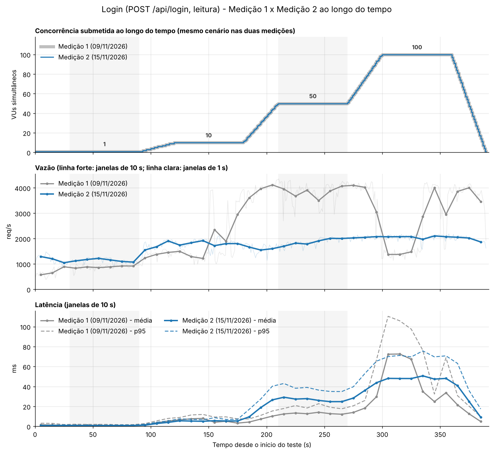

Por nível de concorrência (eixo X categórico: 1, 10, 50 e 100 VUs igualmente espaçados):

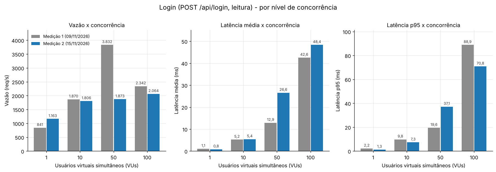

- Até 10 VUs as duas medições são parecidas (e a Medição 2 é melhor com 1 VU). A diferença aparece a partir de 50 VUs, onde a Medição 1 subiu para ≈ 4.000 req/s e a Medição 2 ficou em ≈ 1.900 req/s.
- No tempo, a Medição 1 alterna entre dois regimes de vazão (≈ 1.400 e ≈ 4.000 req/s) sem mudança de carga, enquanto a Medição 2 é uma linha quase reta, entre ≈ 1.550 e ≈ 2.100 req/s depois dos 100 s.

### 3.8 Melhorias/otimizações (arquivos modificados)

As mudanças abaixo foram aplicadas **todas juntas** antes da Medição 2, então o resultado medido não isola a contribuição de cada uma. A coluna *Hipótese* indica qual gargalo da [seção 3.5](#35-medição-1-potenciais-gargalos-do-sistema-hipóteses) a mudança tentava atacar.

| Mudança | Onde | Hipótese | O que se observou |
|---|---|---|---|
| `SELECT *` → `SELECT id, nome, email` | [`server.js` L128 e L133](server.js#L128) | L1 | A resposta caiu de ≈ 773 para ≈ 427 bytes por requisição. Efeito na vazão não isolado. |
| Sessão guarda só `{ id }` (antes, a linha inteira do usuário); resposta sem a senha | [`server.js` L130–L131](server.js#L130-L131) | L1 | Menos dados para o `express-session` calcular o hash da sessão; também corrige a senha voltando ao navegador. Não isolado. |
| Sem `X-Powered-By` e sem ETag (hash SHA-1 em toda resposta) | [`server.js` L29–L32](server.js#L29-L32) | L1 | Não isolado. |
| `express.static` antes do middleware de sessão | [`server.js` L67–L71](server.js#L67-L71) | — | Só ajuda o carregamento das páginas, não a API medida. |
| Pré-aquecimento do pool (`DB_PREWARM`) | [`server.js` L519–L529](server.js#L519-L529) | L2 | Conexões abertas antes da rampa. Nos primeiros 10 s: 1.294 req/s contra 575 req/s. |
| Prepared statements via `consultar()` (`DB_USE_EXECUTE`) | [`server.js` L45–L53](server.js#L45-L53) | L1 | Com 1 VU a latência média caiu 24 %. Com 50 VUs não se pode afirmar o efeito (hipótese L6). |
| Pool configurável (`DB_POOL_SIZE`) | [`server.js` L14–L19 e L41](server.js#L14-L19) | L2 | Medido só com 10 conexões; 25, 50 e 100 não foram medidos. |
| Cluster opcional (`CLUSTER_WORKERS`) | [`server.js` L538–L559](server.js#L538-L559) | L1 | **Não medido** (Medição 2 com 1 processo). Com mais de um worker a sessão em memória deixa de ser compartilhada; para uso real exige um store compartilhado (ex.: `express-mysql-session`). |
| Variáveis novas no modelo de ambiente | [`B.arquivo.env`](B.arquivo.env) | — | `DB_POOL_SIZE`, `CLUSTER_WORKERS`, `DB_PREWARM` e `DB_USE_EXECUTE`. Copie-as para o seu `.env`, porque o `dotenv` só lê o `.env`. |
| MySQL: `innodb_buffer_pool_size` = 1 GB e `innodb_redo_log_capacity` = 2 GB | fora do repositório (`SET PERSIST`) | C2, C3 | Pensado para o Cadastro; o Login só é afetado de forma indireta. |

**Não foram alterados:** `login.js`, `cadastro.js` e `analisar.js` (para a comparação valer) e `mysql/Adopetz.sql` (o `UNIQUE` de `email` e `cpf` é necessário). **A senha continua em texto puro** (L4); o `bcrypt` não foi aplicado, para não invalidar o antes × depois.

### 3.9 Medição 2: potenciais gargalos que restam

| ID | Situação depois da Medição 2 | Evidência | Como validar |
|---|---|---|---|
| L1 | **Não testada** | O teto caiu para ≈ 2.000 req/s, mas o Node continuou com 1 processo; o cluster não foi medido. | Observar o processo `node` (um núcleo perto de 100 %?) e repetir com `CLUSTER_WORKERS=2` e `4` (suba o `max_connections`). |
| L2 | **Não testada** | Pool de 10 nas duas medições. | Medir `DB_POOL_SIZE` = 5, 10, 25, 50 e 100 e desenhar a curva de vazão por tamanho de pool. |
| L3 | **Não reapareceu** | A vazão de 100 VUs ficou estável (≈ 2.080 e ≈ 2.050 req/s nos dois blocos de 30 s). Compatível com causa ambiental, mas sem prova. | Repetir o teste ao menos 3 vezes. |
| L4 | **Mantida de propósito** | Senha em texto puro. | Correção de segurança à parte, com nova medição. |
| **L5** | **Nova:** condições do ambiente diferentes entre as medições | A Medição 1 rodou de madrugada (02:45) e a Medição 2 à tarde (14:54), com a máquina possivelmente com mais programas abertos (não monitorado). A própria Medição 1 mostrou que o ambiente sozinho varia a vazão por um fator de ≈ 3 sem mudança de carga (≈ 1.400 req/s nos primeiros 30 s do patamar de 100 VUs e ≈ 4.000 req/s logo depois). A Medição 2 (≈ 1.800–2.100 req/s) está dentro dessa faixa. | Repetir as duas versões do código (antiga e nova) **no mesmo horário e alternadas**, 3 vezes cada; registrar o uso de CPU por núcleo e o que mais estava aberto. |
| **L6** | **Nova:** efeito das mudanças no caminho do login (`execute`, colunas, sessão) | Com 1 VU tudo melhorou (latência −24 %, vazão +38 %), mas com 50 VUs a vazão caiu 51 %. Não há como saber, com uma rodada só, se alguma mudança custa mais sob concorrência. | Rodar a Medição 2 com `DB_USE_EXECUTE=0` e depois `=1` (e o mesmo com `DB_PREWARM`), sem mexer em mais nada. |

> A Medição 2 sozinha **não permite escolher entre L5 e L6**. As duas podem ter contribuído.

---

## 4. Serviço 2 — Cadastro

| Item | Descrição |
|---|---|
| **Endpoint** | `POST /api/register` |
| **Tipo de operação** | **Inserção**. Medição 1: um `SELECT` para verificar e-mail/CPF duplicados, seguido de um `INSERT` em `usuario`. Medição 2: só o `INSERT` (a duplicidade é tratada pelo erro `ER_DUP_ENTRY`). |
| **Medição 1** | 09/11/2026 (início às 02:58:50, fuso −03:00), sistema original |
| **Medição 2** | 15/11/2026 (início às 15:02:41, fuso −03:00), depois das otimizações |

### 4.1 Arquivos envolvidos

Os números de linha são os da versão atual (otimizada) do `server.js`.

- [`server.js` — rota `POST /api/register` (linhas 144–163)](server.js#L144-L163)
- [`server.js` — função `consultar()` (linhas 45–53)](server.js#L45-L53) e [pool de conexões MySQL (linhas 34–43)](server.js#L34-L43)
- [`B.arquivo.env`](B.arquivo.env) — modelo das variáveis de ambiente, incluindo as da otimização
- [`public/register.html`](public/register.html) — formulário que chama `/api/register`
- [`mysql/Adopetz.sql` — tabela `usuario` (linhas 32–46)](mysql/Adopetz.sql#L32-L46): chave primária mais dois índices `UNIQUE` (`email` e `cpf`)

### 4.2 Arquivos com o código-fonte da medição

- [`testes-de-carga/cadastro.js`](testes-de-carga/cadastro.js) — script k6 (o mesmo nas duas medições). Gera e-mail e CPF **únicos** a cada iteração (o servidor responde `409` se qualquer um repetir; sem isso o teste mediria apenas o erro).
- [`testes-de-carga/analisar.js`](testes-de-carga/analisar.js) e [`testes-de-carga/gerar_graficos.py`](testes-de-carga/gerar_graficos.py)
- Resultados da Medição 1: [`cadastro-resumo.json`](testes-de-carga/resultados/2026-11-09/cadastro-resumo.json) (k6) e [`cadastro-agregado.json`](testes-de-carga/resultados/2026-11-09/cadastro-agregado.json) (janelas)
- Resultados da Medição 2: [`cadastro-resumo.json`](testes-de-carga/resultados/2026-11-15/cadastro-resumo.json) (k6) e [`cadastro-agregado.json`](testes-de-carga/resultados/2026-11-15/cadastro-agregado.json) (janelas)

### 4.3 Descrição das configurações

Máquina, versões e rede são os mesmos nas duas medições (tabela da [seção 2.1](#21-descrição-das-configurações-máquinascontainers)). O que mudou para o Cadastro: **uma consulta a menos por requisição** (sem o `SELECT` de duplicidade), pool de 10 conexões pré-aquecido, prepared statements, e MySQL com **redo log de 2 GB** e **buffer pool de 1 GB**. O `innodb_flush_log_at_trx_commit` continua em 1 (cada commit grava o log em disco).

### 4.4 Medição 1: resultados (SLA observado)

**Data:** 09/11/2026. **Por nível de concorrência:**

| VUs | Vazão (req/s) | Latência média (ms) | p95 (ms) | Máxima (ms) | Erros |
|---:|---:|---:|---:|---:|---:|
| 1 | 125,4 | 7,99 | 11,22 | 43,23 | 0 % |
| 10 | 780,1 | 12,62 | 17,33 | 65,15 | 0 % |
| 50 | 1.007,6 | 49,40 | 80,60 | 1.149,86 | 0 % |
| 100 | 1.268,6 | 78,62 | 111,34 | 242,60 | 0 % |

**Evolução no tempo.** Painel superior: concorrência submetida (VUs simultâneos); meio: vazão; inferior: latência. Mesmo eixo de tempo nos três:

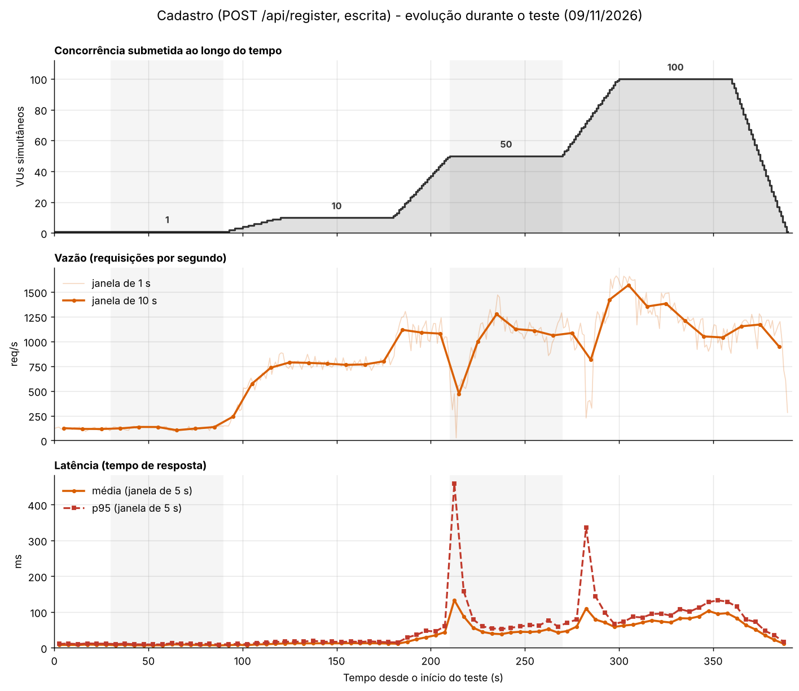

**Concorrência (limite de requisições simultâneas).** Mesmo cenário do Login: rampa 1 → 10 → 50 → 100 VUs (gráfico da [seção 2.2](#22-perfil-de-carga-igual-nos-dois-serviços) e painel superior acima), ou seja, **até ≈ 100 requisições simultâneas**. O limite de falha também não foi atingido: 0 % de erro e p95 de 111,34 ms com 100 VUs. A vazão satura bem antes, **entre 10 e 50 VUs** (780 → 1.008 req/s), e chega a ≈ 1.270 req/s com 100 VUs.

**Leitura dos resultados**

- Com 1 VU cada requisição leva ≈ 8 ms. Com 10 VUs a vazão é 6,2× maior; a partir daí ela cresce pouco: **+29 % de 10 para 50 VUs e +26 % de 50 para 100 VUs**, enquanto a latência média sobe de 12,6 ms para 49,4 ms e 78,6 ms.
- **No patamar de 100 VUs a vazão cai com a carga constante:** de ≈ 1.570 req/s (t = 300 s) para ≈ 1.040 req/s (t = 350 s), e a latência média sobe de 63 ms para 96 ms.
- **Duas paradas curtas, sem erros:**
  - t ≈ 211–214 s (50 VUs): a vazão chegou a **25 req/s** em um segundo e a latência máxima foi de **1.150 ms**.
  - t ≈ 282–285 s (71–76 VUs): vazão de 226–404 req/s e latência máxima de 839 ms.
- O teste inseriu **≈ 308.800 usuários** na tabela `usuario` (veja como limpar na [seção 8](#8-como-reproduzir)).

### 4.5 Medição 1: potenciais gargalos do sistema (hipóteses)

Estas são **hipóteses**: as medições mostram *o que* aconteceu, mas não monitoraram CPU, memória e estado do MySQL durante o teste. Cada item traz a evidência encontrada e um experimento para confirmar ou descartar.

**C1 — Custo da escrita durável (gravação do log de transações do InnoDB a cada `COMMIT`).**
- *Evidência:* com 1 VU o Cadastro leva ≈ 8 ms por requisição contra ≈ 1,1 ms do Login (≈ 7 ms a mais por `SELECT` + `INSERT`). A vazão com 10 VUs é 6,2× a de 1 VU (confirmações de transações agrupadas) e depois satura em ≈ 1.000–1.300 req/s.
- *Como validar:* verificar o valor de `innodb_flush_log_at_trx_commit` (1 = padrão, grava a cada commit); como experimento *apenas de diagnóstico*, repetir com o valor 2 e comparar. Acompanhar `Innodb_os_log_fsyncs` em `SHOW GLOBAL STATUS`.

**C2 — Manutenção de três índices e crescimento da tabela.**
- *Evidência:* cada `INSERT` atualiza a chave primária e os dois índices `UNIQUE` (`email` e `cpf`). No patamar de 100 VUs, com carga constante, a vazão cai de ≈ 1.570 para ≈ 1.040 req/s e a latência sobe de 63 ms para 96 ms enquanto a tabela cresce (≈ 308.800 linhas ao final).
- *Como validar:* repetir o teste com a tabela já populada e vazia e comparar; olhar `SHOW ENGINE INNODB STATUS` durante o patamar de 100 VUs.

**C3 — Paradas curtas (3–4 s) em t ≈ 212 s e t ≈ 282 s.**
- *Evidência:* vazão a 25 req/s e latência máxima de 1.150 ms (50 VUs); depois 226–404 req/s e 839 ms. Os dois eventos estão ≈ 70 s distantes, mas **dois pontos não provam periodicidade**.
- *Hipóteses:* descarga em rajada de páginas/log do InnoDB (checkpoint), pausa de GC do Node ou outro processo do Windows.
- *Como validar:* ativar o *slow query log* (`long_query_time = 0.2`), acompanhar `Innodb_buffer_pool_pages_flushed` e rodar o Node com `--trace-gc`; repetir e ver se as paradas reaparecem nos mesmos instantes.

**C4 — Fila no pool de 10 conexões, com duas passagens por requisição.**
- *Evidência:* a requisição faz duas chamadas separadas a `pool.query` (verificação de duplicidade e `INSERT`), sem transação. Com 100 VUs, 100 requisições disputam 10 conexões e cada uma entra na fila duas vezes; a latência cresce na proporção dos VUs.
- *Como validar:* variar o `connectionLimit` (como em L2) e testar uma versão que faça só o `INSERT`, tratando o erro de duplicidade (`ER_DUP_ENTRY`) com a resposta `409`. Isso elimina uma ida ao banco por requisição e também a janela de corrida entre a verificação e a inserção.

### 4.6 Medição 2: resultados (SLA observado)

**Data:** 15/11/2026 (início às 15:02:41). Mesmo script e mesma rampa da Medição 1. A coluna *Var.* compara com a Medição 1 (tabela da [seção 4.4](#44-medição-1-resultados-sla-observado)).

| VUs | Vazão (req/s) | Var. | Latência média (ms) | Var. | p95 (ms) | Var. | Máxima (ms) | Erros |
|---:|---:|---:|---:|---:|---:|---:|---:|---:|
| 1 | 145,1 | +15,7 % | 6,87 | −14,0 % | 10,27 | −8,5 % | 98,10 | 0 % |
| 10 | 1.110,6 | +42,4 % | 8,85 | −29,9 % | 13,58 | −21,6 % | 102,58 | 0 % |
| 50 | 1.256,7 | +24,7 % | 39,60 | −19,8 % | 54,53 | −32,3 % | 132,59 | 0 % |
| 100 | 1.325,3 | +4,5 % | 75,33 | −4,2 % | 100,56 | −9,7 % | 4.698,82 | 0 % |

**Evolução no tempo** (concorrência, vazão e latência no mesmo eixo de tempo):

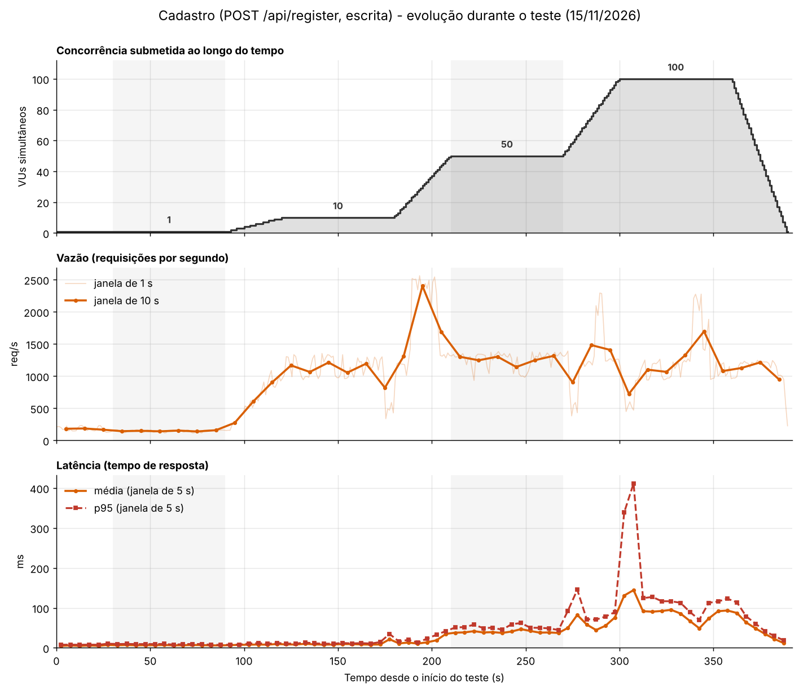

**Concorrência (limite de requisições simultâneas).** Mesmo cenário da Medição 1: **até ≈ 100 requisições simultâneas**. O limite de falha **não foi atingido**: 0 % de erro e p95 de 100,56 ms com 100 VUs. A vazão satura ainda mais cedo: **já em 10 VUs** (1.111 req/s), e chega a ≈ 1.325 req/s com 100 VUs.

**Leitura dos resultados**

- **Menos concorrência, mais ganho.** Com 10 VUs a vazão subiu 42,4 % e a latência média caiu 29,9 %. Com 1 VU, cada requisição ficou ≈ 1,1 ms mais rápida (7,99 → 6,87 ms), valor próximo ao de um `SELECT` do Login com 1 VU na Medição 1 (≈ 1,1 ms), coerente com a consulta que foi removida.
- **A curva ficou mais plana depois de 10 VUs:** +13 % de 10 para 50 VUs e +5 % de 50 para 100 VUs (Medição 1: +29 % e +26 %). A hipótese é que o limite seja a gravação de cada commit (C1), que as otimizações não alteraram.
- **A queda dentro do patamar de 100 VUs diminuiu.** Média de ≈ 1.385 req/s nos primeiros 30 s e ≈ 1.265 req/s nos 30 s seguintes (−9 %); na Medição 1 foi de ≈ 1.436 para ≈ 1.101 req/s (−23 %). A segunda metade da Medição 2 inclui a parada descrita abaixo.
- **Duas paradas, mais longas que as da Medição 1, sem erros:**
  - t ≈ 194–197 s (≈ 30 VUs, durante a subida para 50): 3 segundos seguidos com a vazão em ≈ 10 req/s e latência máxima de **3.139 ms**.
  - t ≈ 340–344 s (100 VUs): 4 segundos seguidos com a vazão em ≈ 11 req/s e latência máxima de **4.699 ms**.
- O teste inseriu **≈ 355.700 usuários** (≈ 15 % a mais que na Medição 1), por causa da maior vazão.

### 4.7 Gráficos comparativos

Os três painéis têm o mesmo eixo de tempo. **Painel superior: concorrência submetida** (a mesma nas duas medições); **meio: vazão** (linha forte = janelas de 10 s, linha clara = janelas de 1 s, onde as paradas aparecem como mergulhos até perto de zero); **inferior: latência** (média cheia e p95 tracejado, janelas de 10 s), com a latência máxima das paradas anotada.

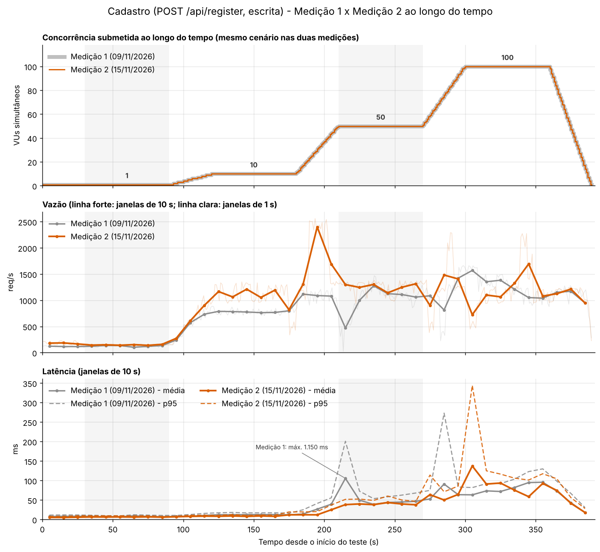

Por nível de concorrência (eixo X categórico: 1, 10, 50 e 100 VUs igualmente espaçados):

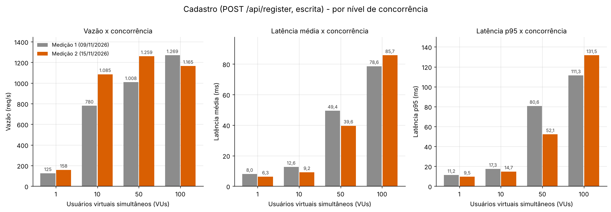

- A Medição 2 é melhor ou igual em vazão, latência média e p95 em **todos** os níveis de concorrência; o ganho encolhe de 10 para 100 VUs.
- A latência máxima é o único indicador que piorou: 1.150 → 4.699 ms. O p95 não mostra isso, porque 3–4 s de parada em 390 s afetam poucas requisições.

### 4.8 Melhorias/otimizações (arquivos modificados)

As mudanças abaixo foram aplicadas **todas juntas** antes da Medição 2, então o resultado medido não isola a contribuição de cada uma. A coluna *Hipótese* indica qual gargalo da [seção 4.5](#45-medição-1-potenciais-gargalos-do-sistema-hipóteses) a mudança tentava atacar.

| Mudança | Onde | Hipótese | O que se observou |
|---|---|---|---|
| **Removido o `SELECT` de duplicidade:** fica só o `INSERT`, e `ER_DUP_ENTRY` vira o mesmo `409` com a mesma mensagem | [`server.js` L144–L163](server.js#L144-L163) | C4 | Duas idas ao banco viram uma e some a janela de corrida entre `SELECT` e `INSERT`. Com 1 VU: −1,12 ms por requisição; com 10 VUs: vazão +42,4 %. Para o front-end nada muda. |
| Pré-aquecimento do pool (`DB_PREWARM`) | [`server.js` L519–L529](server.js#L519-L529) | C4 | Não isolado. |
| Prepared statements via `consultar()` (`DB_USE_EXECUTE`) | [`server.js` L45–L53](server.js#L45-L53) | C4 | Não isolado. |
| Pool configurável (`DB_POOL_SIZE`) | [`server.js` L14–L19 e L41](server.js#L14-L19) | C4 | Medido só com 10 conexões. |
| Sem `X-Powered-By` e sem ETag | [`server.js` L29–L32](server.js#L29-L32) | — | Não isolado. |
| Cluster opcional (`CLUSTER_WORKERS`) | [`server.js` L538–L559](server.js#L538-L559) | — | **Não medido** (Medição 2 com 1 processo). |
| Variáveis novas no modelo de ambiente | [`B.arquivo.env`](B.arquivo.env) | — | `DB_POOL_SIZE`, `CLUSTER_WORKERS`, `DB_PREWARM` e `DB_USE_EXECUTE`. |
| MySQL: `innodb_redo_log_capacity` = 2 GB (antes 100 MB) | fora do repositório (`SET PERSIST`) | C3 | **Não eliminou as paradas** (ver [4.9](#49-medição-2-potenciais-gargalos-que-restam)). |
| MySQL: `innodb_buffer_pool_size` = 1 GB (antes 128 MB) | fora do repositório (`SET PERSIST`) | C2 | A queda dentro do patamar de 100 VUs diminuiu (−23 % → −9 %), com a ressalva da parada; não isolado. |

**Não foram alterados:** `cadastro.js` e `analisar.js` (para a comparação valer) e `mysql/Adopetz.sql` (o `UNIQUE` de `email` e `cpf` é o que permite tratar a duplicidade pelo erro do `INSERT`). O `innodb_flush_log_at_trx_commit = 2` **não foi aplicado**: ele trocaria durabilidade por velocidade (perde até ≈ 1 s de dados se o sistema operacional cair) e só deve ser usado como medição separada, registrando essa troca.

### 4.9 Medição 2: potenciais gargalos que restam

| ID | Situação depois da Medição 2 | Evidência | Como validar |
|---|---|---|---|
| C1 | **Continua sendo o limite** | A vazão passa de 1.111 req/s (10 VUs) para 1.325 req/s (100 VUs), só +19 %. O `innodb_flush_log_at_trx_commit` não foi alterado. | Medição *separada* e só de diagnóstico com valor 2; acompanhar `Innodb_os_log_fsyncs` antes e depois. |
| C2 | **Atenuada** | A queda de vazão dentro do patamar de 100 VUs foi de −23 % para −9 %, mesmo com a tabela chegando a pelo menos 355.700 linhas. | Comparar `Innodb_buffer_pool_reads` com `Innodb_buffer_pool_read_requests` antes e depois do teste; repetir com a tabela vazia. |
| C3 | **Não resolvida; piorou** | Duas paradas de 3–4 s (t ≈ 194 s e t ≈ 340 s), com 10–11 req/s e latência máxima de 3,1 s e 4,7 s (Medição 1: 1,15 s). As paradas apareceram em instantes diferentes dos da Medição 1 (t ≈ 212 s e t ≈ 282 s); com quatro eventos no total não dá para afirmar periodicidade. O redo log de 2 GB não as eliminou. | Acompanhar `Innodb_log_waits`, `Innodb_buffer_pool_pages_flushed` e `Innodb_buffer_pool_wait_free` durante o teste; ativar o *slow query log*; rodar o Node com `--trace-gc` e repetir para ver se reaparecem. |
| C4 | **Atendida em parte** | Uma ida ao banco foi removida (+42,4 % de vazão com 10 VUs). Resta a fila no pool de 10 conexões. | Medir `DB_POOL_SIZE` = 5, 10, 25, 50 e 100 (STAGES=100 basta para achar a vazão máxima de cada tamanho). |

---

## 5. Comparação entre os serviços

### 5.1 Por nível de concorrência

**Medição 2** (15/11/2026). O eixo X é categórico (1, 10, 50 e 100 VUs igualmente espaçados):

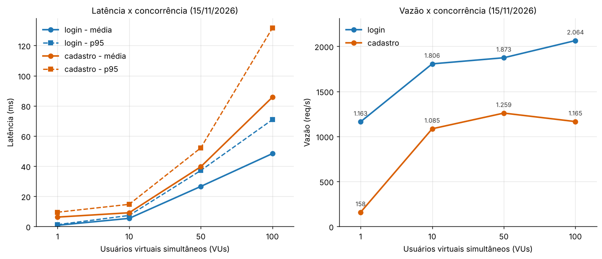

| VUs | Vazão Login | Vazão Cadastro | Média Login | Média Cadastro | p95 Login | p95 Cadastro |
|---:|---:|---:|---:|---:|---:|---:|
| 1 | 1.162,6 | 145,1 | 0,84 ms | 6,87 ms | 1,27 ms | 10,27 ms |
| 10 | 1.805,6 | 1.110,6 | 5,43 ms | 8,85 ms | 7,35 ms | 13,58 ms |
| 50 | 1.873,4 | 1.256,7 | 26,59 ms | 39,60 ms | 37,15 ms | 54,53 ms |
| 100 | 2.064,0 | 1.325,3 | 48,36 ms | 75,33 ms | 70,85 ms | 100,56 ms |

**Medição 1** (09/11/2026), para comparação:

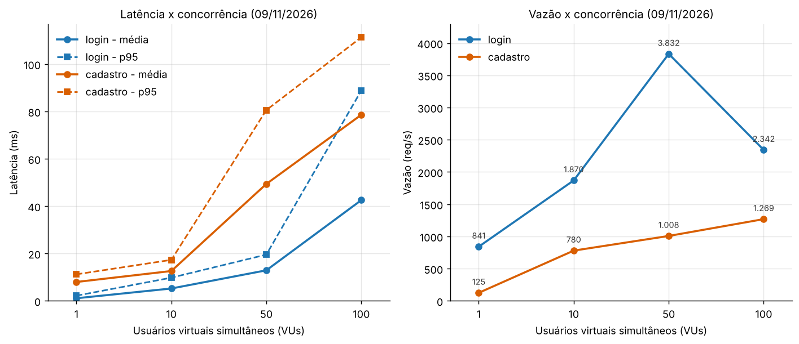

| VUs | Vazão Login | Vazão Cadastro | Média Login | Média Cadastro | p95 Login | p95 Cadastro |
|---:|---:|---:|---:|---:|---:|---:|
| 1 | 841,3 | 125,4 | 1,11 ms | 7,99 ms | 2,20 ms | 11,22 ms |
| 10 | 1.869,7 | 780,1 | 5,24 ms | 12,62 ms | 9,81 ms | 17,33 ms |
| 50 | 3.832,2 | 1.007,6 | 12,92 ms | 49,40 ms | 19,55 ms | 80,60 ms |
| 100 | 2.342,2 | 1.268,6 | 42,57 ms | 78,62 ms | 88,87 ms | 111,34 ms |

A distância entre os serviços diminuiu: na Medição 1 o Login tinha 2,4× (10 VUs) e 3,8× (50 VUs) a vazão do Cadastro; na Medição 2 tem 1,6× e 1,5×.

### 5.2 Ao longo do tempo

Como os dois testes usam o mesmo cenário de concorrência, as curvas podem ser sobrepostas. O painel superior é a concorrência submetida (idêntica nos dois testes); os demais, a vazão e a latência (janelas de 10 s).

**Medição 2:**

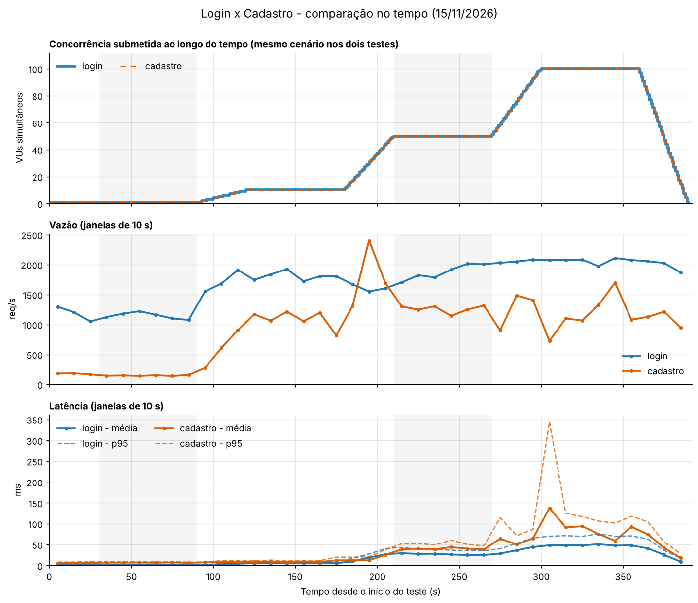

**Medição 1:**

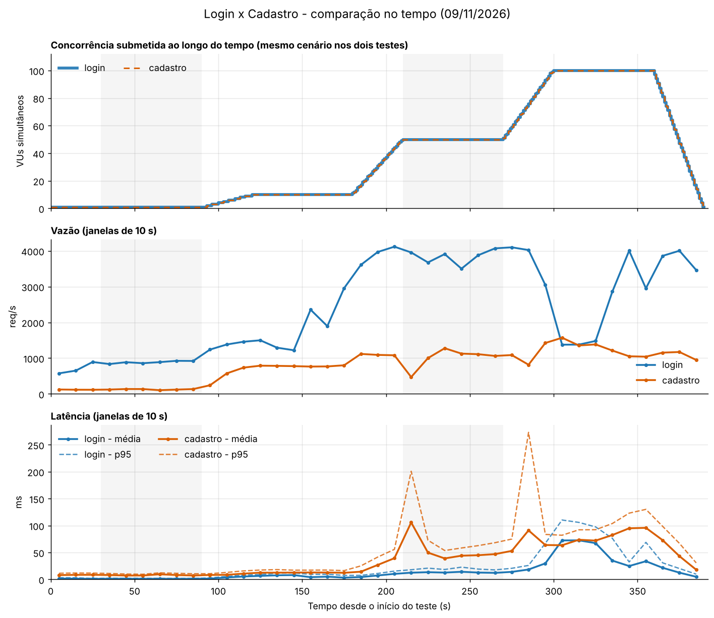

- Na Medição 1 o Login respondia mais rápido e com mais vazão em todos os degraus e era o único a **perder vazão ao subir de 50 para 100 VUs** (ver seção 3.4). Na Medição 2 ele continua à frente, mas com uma curva quase reta a partir de 10 VUs.
- O Cadastro degrada de forma mais gradual nas duas medições; a diferença está nas paradas, que mudaram de instante e ficaram maiores (seções 4.6 e 4.9).
- No patamar de 100 VUs os dois serviços ficam com latência média próxima: 43 ms contra 79 ms na Medição 1 e 48 ms contra 75 ms na Medição 2.

### 5.3 Verificação de consistência (Lei de Little)

Como não há tempo de espera, a concorrência é fixa (= VUs) e deve valer **latência ≈ VUs ÷ vazão**. Os dados das duas medições confirmam:

| VUs | Login M1: VUs ÷ vazão | Login M1: média | Cadastro M1: VUs ÷ vazão | Cadastro M1: média |
|---:|---:|---:|---:|---:|
| 10 | 5,35 ms | 5,24 ms | 12,82 ms | 12,62 ms |
| 50 | 13,05 ms | 12,92 ms | 49,62 ms | 49,40 ms |
| 100 | 42,70 ms | 42,57 ms | 78,83 ms | 78,62 ms |

| VUs | Login M2: VUs ÷ vazão | Login M2: média | Cadastro M2: VUs ÷ vazão | Cadastro M2: média |
|---:|---:|---:|---:|---:|
| 10 | 5,54 ms | 5,43 ms | 9,00 ms | 8,85 ms |
| 50 | 26,69 ms | 26,59 ms | 39,79 ms | 39,60 ms |
| 100 | 48,45 ms | 48,36 ms | 75,45 ms | 75,33 ms |

Isso valida as duas medições e mostra que, depois de saturar, a latência é principalmente **tempo de espera em fila**. Não diz, porém, *onde* está a fila (Node, pool de conexões, MySQL ou o próprio k6 disputando CPU). Essa é a pergunta das hipóteses de gargalo (seções 3.5, 3.9, 4.5 e 4.9, resumidas na seção 6).

---

## 6. Levantamento de hipóteses dos gargalos

As hipóteses de cada serviço estão detalhadas **dentro da seção do próprio serviço**, cada uma com a evidência encontrada nos dados e um experimento para confirmar ou descartar: [3.5 — Login (Medição 1)](#35-medição-1-potenciais-gargalos-do-sistema-hipóteses), [3.9 — Login (Medição 2)](#39-medição-2-potenciais-gargalos-que-restam), [4.5 — Cadastro (Medição 1)](#45-medição-1-potenciais-gargalos-do-sistema-hipóteses) e [4.9 — Cadastro (Medição 2)](#49-medição-2-potenciais-gargalos-que-restam). O quadro abaixo é o resumo.

| ID | Serviço | Hipótese de gargalo | Evidência principal (Medição 1) | Situação depois da Medição 2 |
|---|---|---|---|---|
| L1 | Login | CPU do Node (thread única) como teto de vazão | Vazão estaciona em ≈ 4.100 req/s a partir de 50 VUs, com consulta trivial | Não testada (cluster não medido) |
| L2 | Login | Fila no pool de 10 conexões do MySQL | Até 90 requisições esperando conexão com 100 VUs; latência cresce com os VUs | Não testada (pool 10 nas duas medições) |
| L3 | Login | Instabilidade ambiental no patamar de 100 VUs | Vazão cai de ≈ 4.000 para ≈ 1.400 req/s por ≈ 35 s e volta sozinha, sem erros | Não reapareceu |
| L4 | Login | Custo de autenticação irrealisticamente baixo (senha em texto puro) | `WHERE email = ? AND senha = ?`; o `bcrypt` não é usado | Mantida de propósito |
| L5 | Login | Condições do ambiente diferentes entre as medições (horário, carga da máquina) | — (surgiu na Medição 2) | Aberta |
| L6 | Login | Efeito das mudanças no caminho do login sob concorrência (`execute`, colunas, sessão) | — (surgiu na Medição 2) | Aberta |
| C1 | Cadastro | Custo da escrita durável (commit no InnoDB) | ≈ 8 ms por requisição com 1 VU, contra ≈ 1,1 ms do Login | Continua sendo o limite |
| C2 | Cadastro | Manutenção de 3 índices e crescimento da tabela | Vazão cai de ≈ 1.570 para ≈ 1.040 req/s no patamar de 100 VUs | Atenuada (queda de −23 % para −9 %) |
| C3 | Cadastro | Paradas curtas (3–4 s) | Vazão a 25 req/s e latência máxima de 1.150 ms | **Não resolvida; piorou** (3,1 s e 4,7 s) |
| C4 | Cadastro | Fila no pool, com duas passagens por requisição | Duas chamadas `pool.query` por requisição; latência proporcional aos VUs | Atendida em parte (1 consulta a menos) |

---

## 7. Limitações da medição

- **Gerador de carga e servidor na mesma máquina** (via `localhost`): k6, Node e MySQL disputam CPU e não há latência de rede real. Os números medem o conjunto, não o servidor isolado.
- **Sem tempo de espera entre requisições:** 100 VUs aqui geram muito mais pressão do que 100 pessoas reais.
- **O limite do sistema não foi encontrado:** não houve nenhum erro até 100 VUs. Para achar o ponto de ruptura, rodar mais degraus, por exemplo `-e STAGES=100,200,400,800`.
- **Execução única de cada teste em cada medição:** a variabilidade entre execuções é desconhecida (ver L3, L5 e C3). Diferenças pequenas entre as medições não devem ser lidas como ganho ou perda.
- **As duas medições não foram feitas nas mesmas condições:** a Medição 1 foi de madrugada (02:45–03:05) e a Medição 2 à tarde (14:54–15:09), e não foram coletadas métricas da máquina. Isso limita principalmente a leitura do Login (L5).
- **As otimizações foram aplicadas todas juntas** (código e MySQL), então não há como atribuir o resultado a cada uma. Para isso, repita a Medição 2 mudando uma chave por vez (`DB_USE_EXECUTE`, `DB_PREWARM`, `DB_POOL_SIZE`, `CLUSTER_WORKERS` e as variáveis do MySQL).
- **Cluster e tamanhos de pool diferentes de 10 estão implementados, mas não foram medidos.**
- **Valores anteriores do MySQL:** os da Medição 1 são os padrões do MySQL 8.4 (nota da [seção 2.1](#21-descrição-das-configurações-máquinascontainers)).
- **Estado da tabela `usuario` no Login da Medição 2 não registrado.** Na Medição 1 ela tinha 3 linhas. Se o `DELETE` da [seção 8](#8-como-reproduzir) não tiver sido executado antes, o Login rodou com a tabela cheia (≈ 308.800 linhas). O efeito esperado é pequeno (a busca pelo índice `UNIQUE` cresce de forma logarítmica), mas não foi medido.
- **Caminho de erro do Login não medido:** com credenciais inválidas o servidor faz uma segunda consulta (`administrador`).
- Não foram coletadas métricas do servidor (CPU, memória, estado do MySQL), apenas as do k6.

---

## 8. Como reproduzir

Pré-requisitos: [k6](https://k6.io/docs/getting-started/installation/), Node.js, MySQL em execução e o servidor rodando (`node server.js`, porta 3000). Execute os comandos a partir da pasta `testes-de-carga/` e crie antes a pasta do dia (`resultados/AAAA-MM-DD`).

**Medição 2 — configuração (antes de rodar):**

```sql
-- No MySQL (como root). Anote os valores atuais antes de mudar:
SELECT VERSION();
SHOW VARIABLES LIKE 'innodb_redo_log_capacity';
SHOW VARIABLES LIKE 'innodb_buffer_pool_size';
SHOW VARIABLES LIKE 'innodb_flush_log_at_trx_commit';
SHOW VARIABLES LIKE 'max_connections';

-- SET PERSIST grava no mysqld-auto.cnf e sobrevive ao reinício do MySQL
SET PERSIST innodb_redo_log_capacity = 2147483648;  -- 2 GB (padrão 100 MB)
SET PERSIST innodb_buffer_pool_size  = 1073741824;  -- 1 GB (padrão 128 MB)

-- Espere terminar o redimensionamento do buffer pool antes de rodar o k6
SHOW STATUS LIKE 'Innodb_buffer_pool_resize_status';
```

No `.env` (copie de [`B.arquivo.env`](B.arquivo.env); o `dotenv` só lê o `.env`): `DB_POOL_SIZE=10`, `CLUSTER_WORKERS=1`, `DB_PREWARM=1`, `DB_USE_EXECUTE=1`. Para a **Medição 1** (comportamento original), use `DB_PREWARM=0` e `DB_USE_EXECUTE=0` e deixe o MySQL com os valores padrão (`RESET PERSIST innodb_redo_log_capacity;` e `RESET PERSIST innodb_buffer_pool_size;`).

Para a medição ser comparável: mesma máquina e mesma versão do k6, reinicie o Node e o MySQL antes de cada teste e rode o `DELETE` abaixo antes do Cadastro.

**Testes e gráficos:**

```bash
cd testes-de-carga

# Login (use um e-mail e senha de usuário já cadastrado)
k6 run -e LOGIN_EMAIL=usuario@exemplo.com -e LOGIN_SENHA=sua_senha --summary-export=resultados/2026-11-15/login-resumo.json --out json=resultados/2026-11-15/login.json login.js

# Cadastro
k6 run --summary-export=resultados/2026-11-15/cadastro-resumo.json --out json=resultados/2026-11-15/cadastro.json cadastro.js

# Reduz o JSON bruto (vários GB, não versionado) a janelas de 1 s, 5 s e 10 s
node analisar.js resultados/2026-11-15/login.json
node analisar.js resultados/2026-11-15/cadastro.json

pip install matplotlib

# Gráficos de uma medição, em graficos/2026-11-15/
python gerar_graficos.py 2026-11-15

# Gráficos de cada medição + comparativos Medição 1 x Medição 2,
# em graficos/comparativo_2026-11-09_vs_2026-11-15/
python gerar_graficos.py 2026-11-09 2026-11-15
```

Para a Medição 1, troque a data nos comandos por `2026-11-09`.

Opções dos scripts k6 (`-e NOME=valor`): `BASE_URL` (padrão `http://localhost:3000`), `STAGES` (padrão `1,10,50,100`) e `THINK_TIME` (padrão `0`).

**Limpeza após o teste de cadastro.** Os usuários de teste têm e-mail no formato `user_<execução>_<VU>_<iteração>@teste.com`:

```sql
DELETE FROM usuario WHERE email LIKE 'user\_%@teste.com';
```

---

## 9. Ferramentas e links úteis

- [k6](https://k6.io/) v2.3.0 — geração de carga
- [Tipos de teste do k6](https://grafana.com/docs/k6/latest/testing-guides/test-types/)
- [Saída em JSON do k6](https://grafana.com/docs/k6/latest/results-output/real-time/json/) — base do `analisar.js`
- Node.js (`analisar.js`), Python + matplotlib (`gerar_graficos.py`), MySQL 8.4.7

**Referências consultadas para as otimizações**

- [O que é o problema de N+1](https://medium.com/linkapi-solutions/o-que-%C3%A9-o-problema-de-n-1-24975a28dcb8) (a remoção do `SELECT` do Cadastro é uma *ida redundante ao banco*; não há N+1 nestas rotas)
- [Connection Pool — DevMedia](https://www.devmedia.com.br/connection-pool/5869)
- [Connection pooling — Prisma Data Guide](https://www.prisma.io/dataguide/database-tools/connection-pooling)
- [The anatomy of connection pooling — Vlad Mihalcea](https://vladmihalcea.com/the-anatomy-of-connection-pooling/)
- [Maximum database connections — Vlad Mihalcea](https://vladmihalcea.com/maximum-database-connections/)
- [Como reduzimos em 90% o tempo de resposta de um serviço core do Will](https://medium.com/tech-will/como-reduzimos-em-90-o-tempo-de-resposta-de-um-servi%C3%A7o-core-do-will-265cef6aadc) (formato antes → depois com variação percentual)
